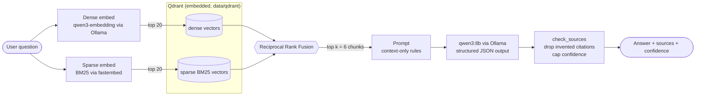
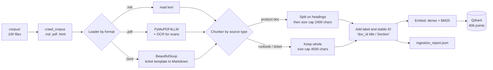
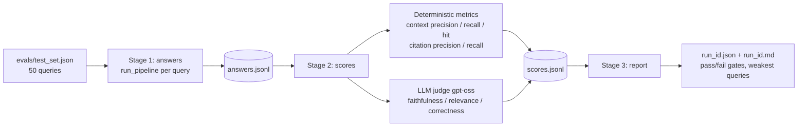

# Helix Support Assistant (LLM RAG)

A fully local retrieval-augmented generation (RAG) system that answers questions for the Helix Customer Success team. It ingests a mixed-format knowledge base (Markdown docs, PDF runbooks, HTML support tickets), indexes it for hybrid search, and returns a structured answer with checked citations and a confidence level. An evaluation harness scores the whole pipeline against a 50-question test set.

Everything runs on your machine: Ollama serves the models and Qdrant runs embedded as a plain folder. No API keys, no external services.

## Contents

- [How it works](#how-it-works)
- [Architecture](#architecture)
- [Architecture decisions](#architecture-decisions)
- [Project layout](#project-layout)
- [Getting started](#getting-started)
- [Usage](#usage)
- [Testing](#testing)
- [Evaluation](#evaluation)
- [Configuration](#configuration)
- [Known limitations and next steps](#known-limitations-and-next-steps)

## How it works

1. **Ingest** (offline, once): crawl the corpus, parse each format into clean Markdown, chunk it, embed every chunk twice (dense and BM25 sparse), and write both vectors to Qdrant.
2. **Retrieve** (per question): embed the question both ways, fetch candidates from each index, and fuse the rankings with reciprocal rank fusion (RRF).
3. **Generate** (per question): hand the top chunks to a local LLM that must answer from the context only and reply in a fixed JSON schema (`answer`, `sources`, `confidence`).
4. **Verify**: code checks that every cited source was actually retrieved, drops invented ones, and can lower (never raise) the model's confidence.

## Architecture

### Query path



### Ingestion path



### Evaluation path



## Architecture decisions

| Decision | Choice | Why |
|---|---|---|
| Serving models | Ollama, all local | No API keys or per-token cost, private data stays on the machine, easy to swap models by changing one setting. |
| Vector store | Embedded Qdrant (a folder) | Zero infrastructure for a corpus of this size. Supports named dense and sparse vectors and server-side fusion, so one store covers hybrid search. Trade-off: only one process can open the folder at a time, so retrieval shares a single client (`get_client`). |
| Retrieval | Hybrid: dense + BM25, fused with RRF | Dense catches paraphrases, BM25 catches exact terms such as error codes, plan names and limits. RRF needs no score normalisation across the two rankers. Both vectors are stored, so `dense` and `sparse` modes remain available as baselines to measure hybrid against. |
| Dense embeddings | `qwen3-embedding:0.6b` | Small enough to run on a laptop, strong retrieval quality for its size. |
| Chunking | Structure-aware, per source type | Product docs are split on Markdown headings (`#` to `###`) and only size-split when a section exceeds 2400 chars. Runbooks and tickets stay whole (up to 4000 chars) because they are short and lose meaning when cut. The heading path is kept as a `Section` label. |
| Chunk labels | `[doc_id] title` prepended to every chunk | The label is what the search indexes see and what the LLM copies when citing, so citation IDs are grounded in the text itself rather than in separate metadata. |
| Chunk IDs | UUIDv5 of `doc_id#index` | Deterministic, so re-ingesting never duplicates and eval runs stay comparable. |
| Parsing | Per-format loaders | PDFs go through PyMuPDF4LLM with OCR enabled, because 5 of the 25 runbooks are scanned images. Tickets are HTML from a fixed template, so BeautifulSoup converts them to Markdown and drops customer and agent names, which are noise for retrieval. |
| Generation | `qwen3:8b`, temperature 0, fixed seed, thinking off | Repeatable output so eval runs can be compared, and faster, cleaner JSON. `num_ctx` is set explicitly to 8192 because Ollama's default can silently truncate the retrieved chunks. |
| Output contract | Pydantic `SupportAnswer` via structured output | The answer, the cited sources and a `low`/`medium`/`high` confidence arrive as typed data. The chain retries once on bad output, then returns a safe fallback instead of crashing. |
| Hallucination guard | `check_sources` in code, not in the prompt | The model's citations are intersected with what was actually retrieved. Invented sources are dropped, and confidence can only go down. The prompt also tells the model to ignore instructions found inside the context (basic prompt-injection hygiene). |
| Evaluation | Separate generator and judge models | The judge (`gpt-oss`) is a different, stronger model than the generator, to avoid a model grading its own work. Retrieval and citation metrics are deterministic and need no LLM, so they are cheap and reproducible. |
| Eval harness | Three resumable stages writing JSONL | A crash never loses finished work. Running `answers` and `scores` separately keeps the generator and judge from being loaded in memory at the same time. |
| Config | One `Settings` class (pydantic-settings) | Every tunable lives in one place and can be overridden by environment variable or `.env`. |

## Project layout

```
.
├── app/
│   ├── config.py              # all settings (models, paths, k, context sizes)
│   ├── crawl_corpus.py        # find .md / .pdf / .html files, skip hidden files
│   ├── pipeline.py            # retrieve + generate; CLI entry point
│   ├── retrieve.py            # hybrid / dense / sparse search over Qdrant
│   ├── generate.py            # prompt, structured output, citation checking
│   └── ingestion/
│       ├── main.py            # ingestion CLI: crawl, load, chunk, embed, index
│       ├── loader.py          # per-format parsers (md, pdf with OCR, html tickets)
│       ├── chunking.py        # structure-aware chunking, labels, stable IDs
│       ├── embedding.py       # dense (Ollama) and sparse (BM25) embedders
│       └── vector_store.py    # build and open the embedded Qdrant collection
├── evals/
│   ├── harness.py             # staged eval runner and report writer
│   ├── metrics.py             # deterministic retrieval and citation metrics
│   ├── judges.py              # LLM-judged faithfulness, relevance, correctness
│   ├── test_set.json          # 50 questions with ground truth and expected sources
│   └── results/               # one folder + .json + .md per run
├── tests/                     # offline unit tests (pytest)
│   ├── conftest.py            # shared helpers, blocks accidental Ollama calls
│   ├── test_ingest.py         # crawl, load, chunk, ingestion report
│   ├── test_retrieve.py       # dense / sparse / hybrid search on in-memory Qdrant
│   ├── test_generate.py       # prompt, citation checking, retries, fallbacks
│   └── test_evals.py          # metrics, judges, harness, test-set consistency
├── corpus/                    # the Helix knowledge base (100 documents)
│   ├── product-docs/          # 60 Markdown files
│   ├── runbooks/              # 25 PDFs (5 scanned)
│   └── tickets/               # 15 HTML support tickets
├── data/qdrant/               # generated index (git-ignored)
└── chunk_test.py              # scratch notebook-style chunking experiments
```

## Getting started

### Prerequisites

- Python 3.13 (see `.python-version`)
- [uv](https://docs.astral.sh/uv/) for dependency management
- [Ollama](https://ollama.com/) running locally (default `http://localhost:11434`)
- Enough memory for an 8B model; the judge model (`gpt-oss`) is larger, so run the eval stages separately on a small machine

### Install

```bash
uv sync
```

### Pull the models

```bash
ollama pull qwen3-embedding:0.6b   # dense embeddings
ollama pull qwen3:8b               # answer generation
ollama pull gpt-oss                # evaluation judge (only needed for evals)
```

The BM25 sparse model (`Qdrant/bm25`) is downloaded automatically by fastembed on first use.

### Build the index

```bash
uv run python -m app.ingestion.main
```

This rebuilds the Qdrant collection from scratch on every run (about 20 seconds for the full corpus) and writes `evals/results/ingestion_report.json`. Expected output for the bundled corpus: 100 files found, 0 failed, 406 chunks.

To check parsing and chunking without Ollama:

```bash
uv run python -m app.ingestion.main --no-embed
```

## Usage

Ask a question:

```bash
uv run python -m app.pipeline "How do I roll back a bad deploy?"
```

Example output shape:

```
<answer, with numbered steps for procedures>

Sources:
  - runbooks/engineering/deploy-rollback.pdf
Confidence: high

(retrieved 6 chunks from 5 documents: 0.9s retrieve, 4.7s generate)
```

Options:

| Flag | Meaning |
|---|---|
| `--k N` | Number of chunks to retrieve (default 6) |
| `--mode hybrid\|dense\|sparse` | Retrieval strategy (default `hybrid`) |
| `--json` | Print the full result, including retrieved contexts and timings |

Use it from Python:

```python
from app.pipeline import run_pipeline

result = run_pipeline("How long can a workflow run before it times out?")
print(result["answer"], result["sources"], result["confidence"])
```

## Testing

```bash
uv run python -m pytest tests/
```

The suite runs fully offline in a few seconds: no Ollama, no model downloads and no built index are needed. An autouse fixture in `tests/conftest.py` fails any test that tries to reach Ollama, so a missing mock shows up as an error instead of a hang.

| File | Covers |
|---|---|
| `test_ingest.py` | Corpus crawling (hidden and unsupported files skipped), per-format loading, heading-aware chunking, labels, stable chunk IDs, and the `--no-embed` ingestion report |
| `test_retrieve.py` | Dense, sparse and hybrid retrieval against a real in-memory Qdrant, `k` handling, invalid modes, and the missing-index error |
| `test_generate.py` | `check_sources` (invented citations dropped, confidence only lowered), the retry and fallback paths, and prompt guard rules, using a stand-in LLM |
| `test_evals.py` | Retrieval and citation metrics, the LLM judges with fake models, the full harness (including resume and the pass/fail gates), and a check that every `expected_sources` path in `evals/test_set.json` exists in the corpus |

Not covered: the PDF OCR path (the PDF test stubs the reader) and anything that needs a live model. Use the evaluation harness below for end-to-end quality.

## Evaluation

The harness runs the 50-question test set through the pipeline and scores it.

```bash
uv run python -m evals.harness                  # everything: answers, scores, report
uv run python -m evals.harness --limit 3        # quick smoke test
uv run python -m evals.harness --no-judge       # retrieval and citation metrics only (fast)
uv run python -m evals.harness --mode dense     # compare retrieval modes
uv run python -m evals.harness --run-id v1 --stage scores   # re-score a saved run
```

Stages are resumable. Re-using a `--run-id` continues where the run stopped.

| Stage | Produces |
|---|---|
| `answers` | `evals/results/<run_id>/answers.jsonl` |
| `scores` | `evals/results/<run_id>/scores.jsonl` |
| `report` | `evals/results/<run_id>.json` and `<run_id>.md` |

### Metrics

| Metric | Type | Meaning |
|---|---|---|
| Context precision | Deterministic | Rank-aware share of retrieved chunks that come from an expected document. Pass mark: 0.60 |
| Context recall | Deterministic | Share of expected documents that were retrieved |
| Context hit rate | Deterministic | Share of queries with at least one expected document retrieved |
| Citation precision / recall | Deterministic | Cited sources compared with expected sources |
| Faithfulness | LLM judge | Share of answer statements supported by the retrieved context. Pass mark: 0.70 |
| Answer relevance | LLM judge | How well the answer addresses the question |
| Answer correctness | LLM judge | Correct (1), partial (0.5) or incorrect (0) against the ground truth and notes |

Each report also breaks scores down by difficulty and category and lists the weakest queries with the judge's reasoning, which makes failures easy to diagnose.

### Latest smoke run (3 easy queries)

| Metric | Score |
|---|---|
| Context precision | 0.69 (pass) |
| Context recall | 1.00 |
| Faithfulness | 1.00 (pass) |
| Answer correctness | 1.00 |

This is only a 3-query sample; run the full set for a meaningful baseline.

## Configuration

All settings live in [app/config.py](app/config.py). Override any of them with an environment variable (uppercase name) or a `.env` file in the project root.

| Setting | Default | Purpose |
|---|---|---|
| `corpus_dir` | `corpus` | Where documents are read from |
| `qdrant_path` | `data/qdrant` | Embedded Qdrant folder |
| `qdrant_collection` | `helix_support` | Collection name |
| `ollama_base_url` | `http://localhost:11434` | Ollama server |
| `dense_model` | `qwen3-embedding:0.6b` | Dense embedding model |
| `sparse_model` | `Qdrant/bm25` | Sparse keyword model |
| `retrieval_k` | `6` | Chunks passed to the LLM |
| `generation_model` | `qwen3:8b` | Answer model |
| `num_ctx` | `8192` | Context window; must fit chunks, prompt and answer |
| `max_answer_tokens` | `1024` | Answer length cap |
| `judge_model` | `gpt-oss:latest` | Evaluation judge |
| `judge_reasoning` | `low` | Judge thinking effort |
| `judge_num_ctx` | `16384` | Judge context window |

Changing `dense_model` requires re-running ingestion, since the stored vectors must come from the same model as the query vectors.

## Known limitations and next steps

- **Single-process index.** Embedded Qdrant allows one connection at a time. Move to a Qdrant server if you need concurrent access or an API layer.
- **Full rebuild on ingest.** Ingestion recreates the collection every time. Stable chunk IDs make an incremental upsert path straightforward to add.
- **No reranker.** Precision is limited by first-stage retrieval (the sample run shows unrelated tickets and docs ranking in the top 6). A cross-encoder reranker over the top 20 candidates is the most likely quality win.
- **RRF scores are rank-only.** The `score` in chunk metadata for hybrid mode reflects position, not similarity, so it cannot be used as a relevance cutoff.
- **Citation noise.** The model sometimes cites an extra, loosely related document, which lowers citation precision.
- **Stale hints.** Some docstrings and the missing-index error message still refer to `python -m ingestion.main`; the correct command is `python -m app.ingestion.main`.
- **Stub files.** `main.py` is a placeholder and `chunk_test.py` is exploratory scratch code.
- **No live-model tests.** The unit tests are fully offline; there is no automated integration test against a running Ollama yet.

## The corpus

Helix is a fictional B2B workflow automation platform; every fact, plan, limit and policy is defined inside the corpus, so each test question has an unambiguous answer. See [corpus/README.md](corpus/README.md) for details on the document set, including the scanned PDFs and cross-referenced facts.
